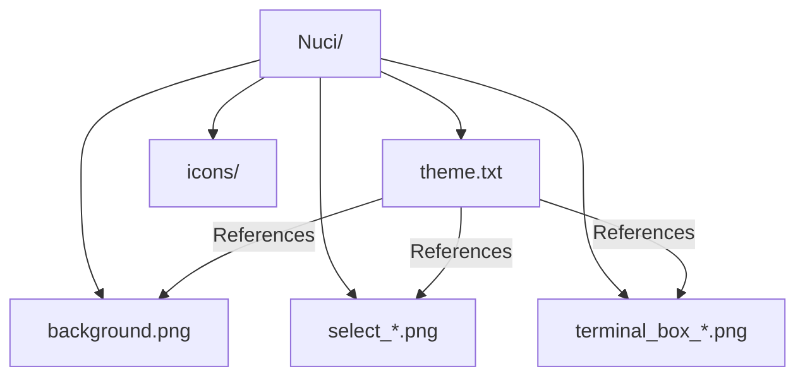
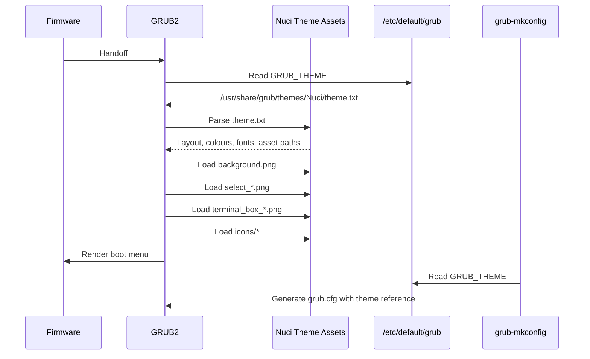
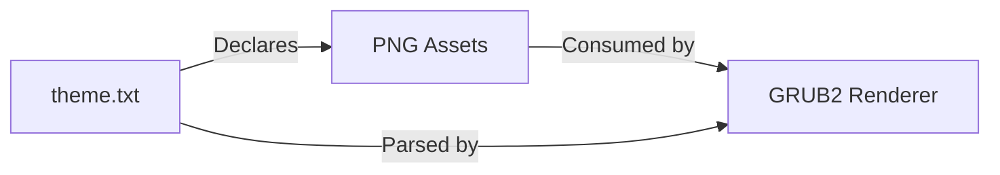

# GRUB2 Theme Nuci Architecture

This document describes the current architecture of the GRUB2 Theme Nuci repository, a static GRUB2 theme package with no runtime logic, executable code, or build process.

## 📑 Table of Contents

- [Purpose](#purpose)
- [System Context](#system-context)
- [Architectural Style](#architectural-style)
- [Runtime Flow](#runtime-flow)
- [Architectural Areas](#architectural-areas)
- [Data Architecture](#data-architecture)
- [Interfaces and Integrations](#interfaces-and-integrations)
- [Dependency Direction and Rules](#dependency-direction-and-rules)
- [External Dependencies](#external-dependencies)
- [Deployment and Operations](#deployment-and-operations)
- [Compatibility Contracts](#compatibility-contracts)
- [Testing and Verification](#testing-and-verification)
- [Design Constraints](#design-constraints)
- [Related Documentation](#related-documentation)

## 🎯 Purpose

This document defines the architectural boundaries of the GRUB2 Theme Nuci repository. The system is a static theme package comprising a theme definition file and raster assets that GRUB2 consumes at boot time. The audience is maintainers and contributors who need to understand the package structure, installation contract, and change impact boundaries. The document records the current architecture; no target architecture is proposed.

## 🌐 System Context

```mermaid
flowchart LR
    User[User / Packager] -->|Copies theme directory| Repo[(grub2-theme-nuci Repository)]
    Repo -->|Installs to| GRUBThemes[/usr/share/grub/themes/Nuci/]
    GRUBThemes -->|Reads theme.txt and assets| GRUB2[GRUB2 Bootloader]
    GRUB2 -->|Renders boot menu| Display[Firmware Framebuffer]
    Config[/etc/default/grub] -->|Sets GRUB_THEME| GRUB2
    GRUBConfig[grub-mkconfig] -->|Generates| GRUBCfg[/boot/grub/grub.cfg]
    GRUBCfg -->|References theme| GRUB2
```

The principal external boundaries are:
- **User / Packager:** Initiates installation by copying the `Nuci` directory to the system GRUB themes folder. Owns the decision to deploy.
- **GRUB2 Bootloader:** Consumes the theme at runtime. Reads `theme.txt` and all referenced PNG assets from the installed location. Owns the rendering pipeline.
- **System Configuration (`/etc/default/grub`):** Declares the theme path via `GRUB_THEME`. Owned by the system administrator.
- **GRUB Configuration Generator (`grub-mkconfig`):** Generates the final `grub.cfg` that references the theme. Owned by the distribution packaging or system administrator.
- **Firmware Framebuffer:** Receives the rendered output. No ownership; hardware boundary.

## 🏗️ Architectural Style

**Static Asset Package** — The repository is a pure data package with no executable code, build pipeline, or runtime process. The architecture is defined by the GRUB2 theme specification: a directory containing a `theme.txt` descriptor and all referenced raster assets. The principal consequence is that every change is a data change; there are no compilation, linking, or dependency-resolution steps. Ownership is flat: the maintainer controls the entire package content.



The principal architecture boundaries are:
- **Package Root (`Nuci/`):** Contains all theme assets. Permitted dependency: none (self-contained).
- **Theme Descriptor (`theme.txt`):** Authoritative source for asset references and layout. Permitted dependency: only assets within `Nuci/`.

## 🔄 Runtime Flow



The principal runtime sequence is:
1. Firmware hands off to GRUB2.
2. GRUB2 reads `GRUB_THEME` from `/etc/default/grub` (populated by `grub-mkconfig`).
3. GRUB2 parses `theme.txt` to obtain layout, colours, fonts, and asset paths.
4. GRUB2 loads all referenced PNG assets from the same directory.
5. GRUB2 renders the boot menu to the firmware framebuffer.

## 🗂️ Architectural Areas

### Theme Package

Paths:
- `Nuci/`

Responsibilities:
- Provide the complete theme descriptor (`theme.txt`).
- Provide all raster assets referenced by `theme.txt` (background, selection sprites, terminal box sprites, icons).
- Maintain internal consistency: every asset path in `theme.txt` must resolve to a file in `Nuci/`.

Boundary rules:
- No external asset references permitted in `theme.txt`.
- No subdirectories other than `icons/` are used.
- All assets are PNG format.

## 💾 Data Architecture



| Data or Store | Owner | Representation and Storage | Lifecycle or Consistency |
|---------------|-------|----------------------------|--------------------------|
| `theme.txt` | Maintainer | Plain text, GRUB2 theme format, UTF-8 | Immutable at runtime; changed only by maintainer commits |
| `background.png` | Maintainer | PNG raster, 16:9 or 4:3 typical | Immutable at runtime; changed only by maintainer commits |
| `select_*.png` (8 files) | Maintainer | PNG raster, directional selection sprites | Immutable at runtime; changed only by maintainer commits |
| `terminal_box_*.png` (9 files) | Maintainer | PNG raster, 9-slice terminal box sprites | Immutable at runtime; changed only by maintainer commits |
| `icons/*` | Maintainer | PNG raster, class icons for boot entries | Immutable at runtime; changed only by maintainer commits |

## 🔌 Interfaces and Integrations

| Interface or Integration | Direction | Contract | Owner | Failure Semantics |
|--------------------------|-----------|----------|-------|-------------------|
| `GRUB_THEME` in `/etc/default/grub` | Inbound (GRUB2 reads) | Absolute path to `theme.txt` | System Administrator | GRUB2 falls back to default theme or text mode |
| `theme.txt` format | Inbound (GRUB2 parses) | GRUB2 theme specification (key-value, blocks) | GRUB2 Upstream | Parse error → fallback to default theme |
| PNG asset loading | Inbound (GRUB2 loads) | Valid PNG, dimensions per theme spec | GRUB2 Upstream | Missing/corrupt asset → render artifact or fallback |
| `grub-mkconfig` generation | Outbound (generates config) | Embeds `GRUB_THEME` into `grub.cfg` | Distribution / Administrator | Omission → theme not applied |

## 🧭 Dependency Direction and Rules

```mermaid
flowchart LR
    GRUB2[GRUB2 Bootloader] -->|Reads| Theme[Nuci Theme Package]
    Config[/etc/default/grub] -->|Points to| Theme
    Gen[grub-mkconfig] -->|Reads| Config
```

The principal dependency rules are:
- The theme package has **no dependencies** on external libraries, frameworks, or tools.
- GRUB2 depends on the theme package (consumer → provider).
- System configuration depends on the theme package installation path.
- No reverse dependencies: the theme package must not reference GRUB2 internals, system paths, or build tools.

## 📦 External Dependencies

| Dependency | Responsibility | Integration Boundary | Architectural Consequence |
|------------|----------------|----------------------|---------------------------|
| GRUB2 (bootloader) | Consumes theme at runtime | `theme.txt` + PNG assets | Theme must conform to GRUB2 theme specification; upstream changes may require theme updates |
| `grub-mkconfig` (config generator) | Generates `grub.cfg` with theme reference | `/etc/default/grub` → `grub.cfg` | Theme path must be stable; relocation breaks generated config |
| Distribution packaging (AUR, etc.) | Packages and installs theme | Copies `Nuci/` to `/usr/share/grub/themes/` | Packaging scripts must preserve directory structure and permissions |

## 🚀 Deployment and Operations

| Concern | Current Design | Architectural Consequence |
|---------|----------------|---------------------------|
| Process topology | None (static assets) | No services, daemons, or processes to manage |
| Deployment unit | Directory `Nuci/` | Atomic copy; no partial installation |
| Persistent state | None | No databases, caches, or mutable state |
| Filesystem requirements | `/usr/share/grub/themes/Nuci/` readable by GRUB2 | Standard POSIX permissions (755 directories, 644 files) |
| Network requirements | None | Fully offline operation |
| Scaling assumptions | Single theme per boot | No horizontal or vertical scaling |
| Startup / shutdown | N/A | GRUB2 loads theme at boot; no shutdown sequence |
| Operator-visible outputs | Boot menu rendering | Visual only; no logs, metrics, or health endpoints |

## 🛡️ Compatibility Contracts

| Contract | Owner | Invariant | Verification | Change Policy |
|----------|-------|-----------|--------------|---------------|
| `theme.txt` format | GRUB2 Upstream | Keys, blocks, and value syntax per GRUB2 spec | GRUB2 parses without error | Backward-compatible only; test with target GRUB2 version |
| Asset filenames in `theme.txt` | Maintainer | Every referenced file exists in `Nuci/` | Manual inspection; `grep` for asset paths | Additions allowed; removals require `theme.txt` update |
| PNG format and dimensions | GRUB2 Upstream | Valid PNG; dimensions suitable for target resolutions | Visual verification at boot | Changes require testing on target hardware/resolutions |
| Installation path `/usr/share/grub/themes/Nuci/` | Distribution / FHS | Stable absolute path | Packaging scripts | Relocation requires `GRUB_THEME` update and `grub-mkconfig` re-run |

## ✅ Testing and Verification

No automated test suite exists. Verification is manual:

1. Install theme to `/usr/share/grub/themes/Nuci/`.
2. Set `GRUB_THEME=/usr/share/grub/themes/Nuci/theme.txt` in `/etc/default/grub`.
3. Run `sudo grub-mkconfig -o /boot/grub/grub.cfg`.
4. Reboot and verify:
   - Background renders correctly.
   - Boot menu layout matches `theme.txt` (position, size, fonts, colours).
   - Selection highlights use `select_*.png` sprites.
   - Terminal box uses `terminal_box_*.png` sprites.
   - Icons display for boot entries.

Material coverage gaps:
- No automated regression testing.
- No multi-resolution or multi-firmware (BIOS/UEFI) test matrix.
- No automated asset integrity checks.

## ⚠️ Design Constraints

- **Static package only:** No build step, no code generation, no templating. All assets are committed directly.
- **GRUB2 theme specification bound:** The theme descriptor and asset layout must conform to the GRUB2 theme format understood by the target GRUB2 version.
- **Single directory deployment:** The entire theme must reside in one directory (`Nuci/`) with a fixed internal structure.
- **No runtime configuration:** The theme cannot adapt to screen resolution, DPI, or firmware type at boot time.
- **Asset format locked to PNG:** GRUB2's theme engine requires PNG for all raster assets.
- **No dependency management:** The package declares no dependencies; consumers (distributions, users) must ensure GRUB2 is present.

## 📚 Related Documentation

- [README.md](./README.md) — Project overview, installation, and usage.
- [CONTRIBUTING.md](./CONTRIBUTING.md) — Contribution guidelines and development setup.
- [SECURITY.md](./SECURITY.md) — Security policy and vulnerability reporting.
- [PRIVACY.md](./PRIVACY.md) — Privacy and data handling statement.
- [CODE_OF_CONDUCT.md](./CODE_OF_CONDUCT.md) — Community conduct standards.
- [LICENSE](./LICENSE) — GPL-3.0-or-later licence terms.