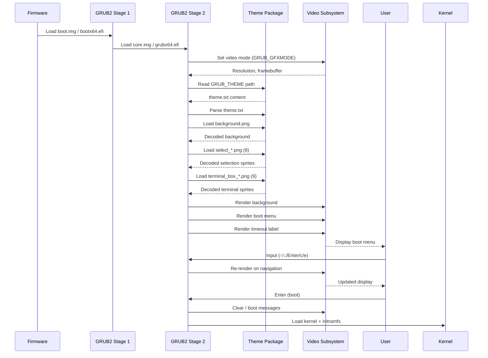

# Theme Load Flow — GRUB2 Theme Nuci

Sequence diagram and description of theme loading during GRUB2 boot.

## Sequence Diagram

## Step-by-Step Flow

### 1. Firmware Handoff
- **BIOS:** Jumps to `boot.img` in MBR gap / partition boot sector
- **UEFI:** Loads `bootx64.efi` from ESP (`/EFI/BOOT/BOOTX64.EFI`)

### 2. GRUB2 Stage 1
- Minimal code (446 bytes MBR / ~1 MB UEFI)
- Loads Stage 2 from known location
- No theme involvement

### 3. GRUB2 Stage 2 Initialisation
- Loads `core.img` (BIOS) or `grubx64.efi` (UEFI)
- Initialises subsystems: video, filesystem, parser, etc.
- Reads `grub.cfg` (generated by `grub-mkconfig`)

### 4. Video Mode Setup
- Reads `GRUB_GFXMODE` from `grub.cfg`
- Sets video mode via VBE (BIOS) or GOP (UEFI)
- Obtains framebuffer address and resolution

### 5. Theme Loading (Conditional)
**Only if `GRUB_THEME` set in `grub.cfg`:**

1. **Read Theme Descriptor**
   - Open `GRUB_THEME` path (`/usr/share/grub/themes/Nuci/theme.txt`)
   - Parse global properties and blocks

2. **Load Assets**
   - `background.png` → decode to framebuffer format
   - `select_*.png` (8 files) → decode all
   - `terminal_box_*.png` (9 files) → decode all
   - Icons → lazy decode on menu population

3. **Validate**
   - Required properties present?
   - Assets decode successfully?
   - If validation fails → fallback to default theme

### 6. Initial Render
1. **Background:** Scale and draw `background.png` to full screen
2. **Boot Menu:** Calculate layout from percentages; render items
3. **Icons:** Match boot entry classes → decode icons
4. **Selection Highlight:** Render around default entry (index 0)
5. **Timeout Label:** Render with initial countdown value
6. **Buffer Swap:** Present to user

### 7. Interactive Loop
- Wait for keyboard input
- On navigation: update selection highlight; dirty-rect redraw
- On timeout tick: update label; dirty-rect redraw
- On `c`/`e`: activate terminal box; render 9-slice frame
- On `Enter`: boot selected entry

### 8. Boot Transition
- Clear theme rendering
- Display boot messages (if `GRUB_TERMINAL_OUTPUT=console`)
- Load kernel and initramfs
- Execute kernel → theme no longer active

## Failure Paths

| Failure Point | Behaviour |
|---------------|-----------|
| `GRUB_THEME` file not found | Silent fallback to default theme |
| `theme.txt` parse error | Silent fallback to default theme |
| `background.png` decode fail | Black background; menu still renders |
| `select_*.png` decode fail | No selection highlight; menu usable |
| `terminal_box_*.png` decode fail | Command line works without frame |
| Icon decode fail | Generic placeholder or no icon |
| Video mode unsupported | Undefined; may fall back to text mode |

## Timing (Typical)

| Stage | Duration |
|-------|----------|
| Stage 1 → Stage 2 | 50-200 ms |
| Video mode set | 10-50 ms |
| Theme parse | < 10 ms |
| Asset decode (all) | 20-100 ms |
| Initial render | < 50 ms |
| **Total to menu** | **100-400 ms** |

## Configuration Dependencies

| Config | Source | Effect on Flow |
|--------|--------|----------------|
| `GRUB_THEME` | `/etc/default/grub` → `grub.cfg` | Enables theme loading |
| `GRUB_GFXMODE` | `/etc/default/grub` → `grub.cfg` | Sets resolution for rendering |
| `GRUB_TIMEOUT` | `/etc/default/grub` → `grub.cfg` | Sets countdown duration |
| `GRUB_DEFAULT` | `/etc/default/grub` → `grub.cfg` | Sets initial selection |

## Related Documents

- [asset-load.md](./asset-load.md) — Asset loading details
- [menu-render.md](./menu-render.md) — Menu rendering flow
- [boot-sequence.md](../behaviour/boot-sequence.md) — Behaviour perspective
- [rendering.md](../behaviour/rendering.md) — Rendering pipeline