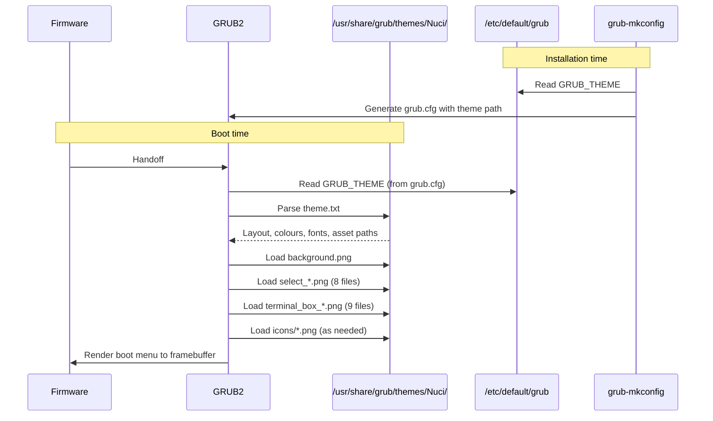

# Integrations — GRUB2 Theme Nuci

This document describes the external system integrations: GRUB2 bootloader, grub-mkconfig, distribution packaging, and system configuration.

## Integration Map

```
┌─────────────────┐     ┌──────────────────┐     ┌─────────────────────┐
│ Distribution    │────▶│ Nuci Theme       │◀───│ GRUB2 Bootloader    │
│ Packaging       │     │ Package          │     │ (Runtime Consumer)  │
│ (AUR, etc.)     │     │ (Nuci/)          │     │                     │
└─────────────────┘     └────────┬─────────┘     └──────────┬──────────┘
                                 │                          │
                                 ▼                          ▼
                        ┌──────────────────┐     ┌─────────────────────┐
                        │ System Config    │     │ Firmware            │
                        │ (/etc/default/    │     │ Framebuffer         │
                        │  grub)           │     │ (Output)            │
                        └────────┬─────────┘     └─────────────────────┘
                                 │
                                 ▼
                        ┌──────────────────┐
                        │ grub-mkconfig    │
                        │ (Config Generator)│
                        └──────────────────┘
```

---

## 1. GRUB2 Bootloader (Runtime Consumer)

**Integration Type:** Inbound consumption — GRUB2 reads theme assets at boot time.

**Interface:** Filesystem read of `/usr/share/grub/themes/Nuci/`

**Contract:**
| Aspect | Specification |
|--------|---------------|
| Entry point | `theme.txt` parsed by GRUB2 theme engine |
| Asset loading | All PNG files referenced by `theme.txt` |
| Rendering target | Firmware framebuffer (VESA/EFI GOP) |
| Font loading | `terminal-font` and `item_font` from theme |
| Sprite rendering | 8-directional selection, 9-slice terminal box |

**Failure Semantics:**
| Failure | GRUB2 Behaviour |
|---------|-----------------|
| `theme.txt` missing | Fallback to default theme |
| `theme.txt` parse error | Fallback to default theme |
| PNG asset missing | Render artifact (blank/missing sprite) |
| PNG corrupt | Render artifact or fallback |
| Font unavailable | Fallback to built-in font |
| Permission denied | Fallback to default theme |

**Version Compatibility:**
- Tested with GRUB 2.06, 2.12
- Theme specification stable across GRUB 2.x
- Monitor GRUB2 changelog for theme engine changes

**Ownership:** GRUB2 upstream owns the consumer; theme package must conform.

---

## 2. grub-mkconfig (Configuration Generator)

**Integration Type:** Inbound generation — reads `GRUB_THEME` and embeds in `grub.cfg`.

**Interface:** Reads `/etc/default/grub` → writes `/boot/grub/grub.cfg`

**Contract:**
| Aspect | Specification |
|--------|---------------|
| Input | `GRUB_THEME=/usr/share/grub/themes/Nuci/theme.txt` in `/etc/default/grub` |
| Output | `grub.cfg` contains `set theme=/usr/share/grub/themes/Nuci/theme.txt` |
| Trigger | Manual (`sudo grub-mkconfig -o /boot/grub/grub.cfg`) or package hook |
| Idempotency | Re-running produces same result |

**Failure Semantics:**
| Failure | Consequence |
|---------|-------------|
| `GRUB_THEME` not set | Theme not embedded in `grub.cfg` |
| Path in `GRUB_THEME` incorrect | GRUB2 cannot find theme at boot |
| `grub-mkconfig` not run | Old `grub.cfg` persists; theme not applied |

**Ownership:** Distribution / system administrator runs; theme package documents requirement.

---

## 3. System Configuration (`/etc/default/grub`)

**Integration Type:** Inbound configuration — declares theme path.

**Interface:** Key-value file edited by administrator or package scripts.

**Contract:**
| Key | Required Value | Description |
|-----|----------------|-------------|
| `GRUB_THEME` | `/usr/share/grub/themes/Nuci/theme.txt` | Absolute path to theme descriptor |

**Management:**
- **Manual:** Administrator edits file, runs `grub-mkconfig`
- **Package hook:** Distribution package may append/modify via install script
- **Conflict:** Multiple themes → last `GRUB_THEME` wins

**Ownership:** System administrator; theme package documents required setting.

---

## 4. Distribution Packaging (AUR, Official Repos)

**Integration Type:** Outbound installation — packages copy theme to system.

**Interface:** Package build script → filesystem copy.

**AUR PKGBUILD Pattern:**
```bash
package() {
  install -dm755 "$pkgdir/usr/share/grub/themes/Nuci"
  cp -r Nuci/* "$pkgdir/usr/share/grub/themes/Nuci/"
  # Optionally: modify /etc/default/grub via install script
}
```

**Contract:**
| Requirement | Specification |
|-------------|---------------|
| Destination | `/usr/share/grub/themes/Nuci/` |
| Permissions | Directories 755, files 644 |
| Structure | Preserve `Nuci/` internal layout exactly |
| Post-install | Recommend `grub-mkconfig` in post-install message |

**Failure Semantics:**
| Failure | Consequence |
|---------|-------------|
| Incomplete copy | Missing assets → render artifacts |
| Wrong permissions | GRUB2 cannot read assets → fallback |
| Path mismatch | `GRUB_THEME` points to non-existent location |
| No post-install hook | User must manually run `grub-mkconfig` |

**Ownership:** Distribution packager; theme package provides source structure.

---

## 5. Firmware Framebuffer (Output Target)

**Integration Type:** Output — GRUB2 renders to firmware-provided framebuffer.

**Interface:** VESA (BIOS) or EFI GOP (UEFI) framebuffer.

**Contract:**
| Aspect | Specification |
|--------|---------------|
| Colour depth | 32-bit (8-8-8-8) or 24-bit (8-8-8) |
| Resolution | Native panel resolution or VESA mode |
| Pixel format | BGRA or RGBX (firmware-dependent) |
| Double buffering | Not used (single frame render) |

**Constraints:**
- Theme assets scaled by GRUB2 to current resolution
- No theme control over resolution or framebuffer setup
- Background image stretched to fill screen

**Ownership:** Hardware/firmware; GRUB2 abstracts; theme package receives result.

---

## Integration Sequence (Boot Flow)



---

## Integration Testing Checklist

| Integration | Test Procedure | Pass Criteria |
|-------------|----------------|---------------|
| GRUB2 → Theme | Install theme; boot; verify menu renders | Background, menu, selection, terminal box, icons visible |
| grub-mkconfig → Config | Set `GRUB_THEME`; run `grub-mkconfig`; inspect `grub.cfg` | `set theme=/usr/share/grub/themes/Nuci/theme.txt` present |
| Packaging → Install | Build package; install; verify `/usr/share/grub/themes/Nuci/` | All files present, permissions 755/644 |
| Config → GRUB2 | Edit `/etc/default/grub`; run `grub-mkconfig`; boot | Theme applied |
| Theme → Firmware | Boot on BIOS and UEFI systems | Renders correctly on both |

---

## Version Compatibility Matrix

| Component | Compatible Versions | Notes |
|-----------|---------------------|-------|
| GRUB2 | 2.04+ | Theme spec stable; test on target distro versions |
| grub-mkconfig | Same as GRUB2 | Bundled with GRUB2 |
| Distribution packaging | Any | PKGBUILD/debian/rules adapt to distro conventions |
| Firmware | Any VESA/EFI GOP | GRUB2 handles abstraction |

---

## Troubleshooting Integration Failures

| Symptom | Likely Integration Failure | Resolution |
|---------|---------------------------|------------|
| Default GRUB theme appears | `GRUB_THEME` not set or `grub-mkconfig` not run | Set `GRUB_THEME`; run `grub-mkconfig` |
| Missing background | `background.png` not installed or wrong path | Verify `/usr/share/grub/themes/Nuci/background.png` exists |
| Selection highlight broken | `select_*.png` incomplete (not 8 files) | Verify all 8 sprites present |
| Terminal box gaps | `terminal_box_*.png` incomplete (not 9 files) | Verify all 9 slices present |
| Icons not showing | Icon filename ≠ boot entry class | Match `class` in GRUB2 config to icon filename |
| Permission denied | Files not 644 / dirs not 755 | `chmod -R 755 /usr/share/grub/themes/Nuci && find ... -type f -exec chmod 644 {} \;` |